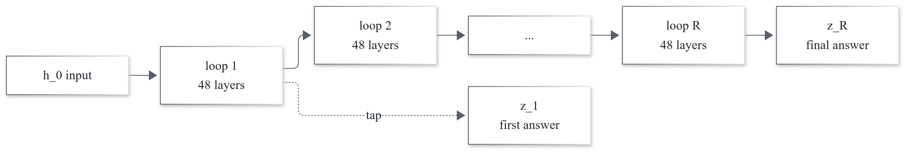
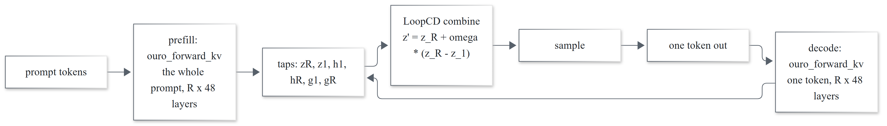
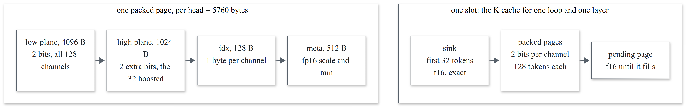
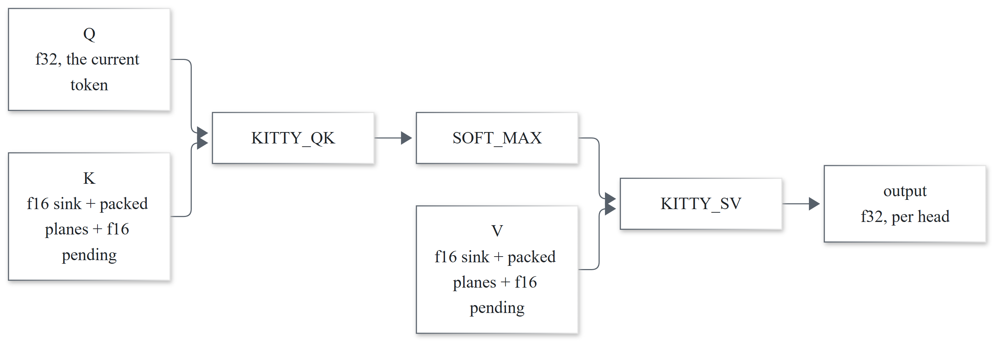
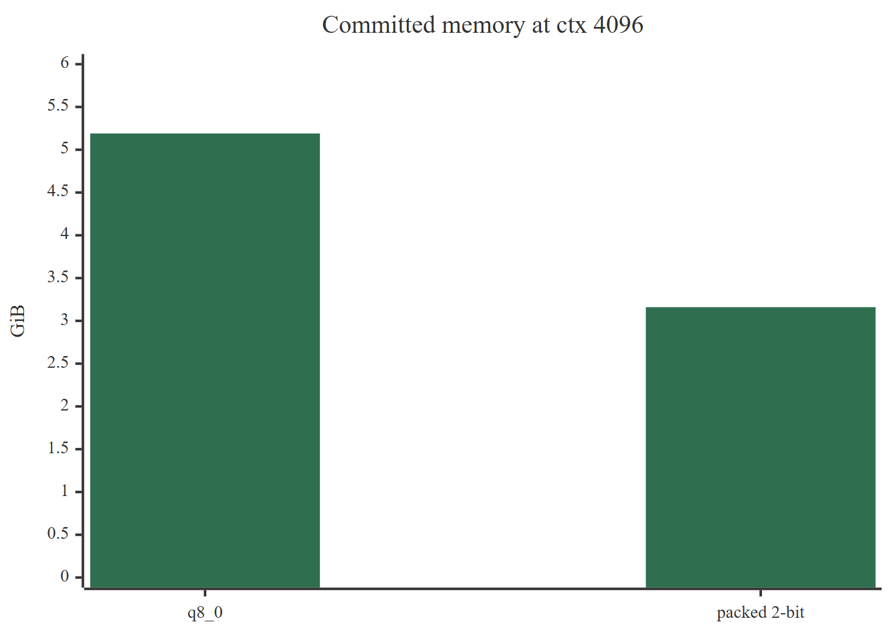
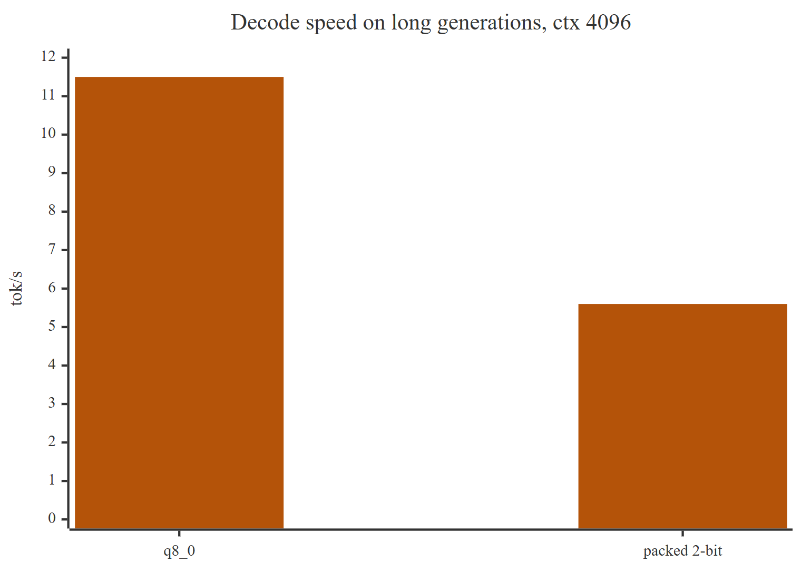

# loopcd + kitty

loopcd is an inference engine for one model, Ouro-2.6B-Thinking. It is C++ on ggml, with a Vulkan
backend on one AMD Radeon 890M iGPU, serving an OpenAI-compatible chat endpoint. It is not a
llama.cpp fork: it links ggml and takes the Ouro graph, the GGUF converter, and the BPE tokenizer
from [llama.cpp PR #29823](https://github.com/ggml-org/llama.cpp/pull/29823).

I built it to test a paper's claim on my own hardware: that LoopCD improves a looped model at
almost no cost. I wanted to measure the cost.

## The model and the method

Ouro has 48 layers and applies them R times, reusing the same weights. The reasoning happens
inside the loop, not in output tokens. R=4 is what the model was trained at.



LoopCD uses the two answers the model already holds, after loop 1 and after loop R, and pushes
probability away from the shallow one and toward the deep one.

```text
Logits form:  z' = z_R + omega * (z_R - z_1)
Hidden form:  z' = lm_head(output_norm(g_R + omega * (g_R - g_1)))
```

`z_k = lm_head(h_k)`, and `omega` is the strength. Ouro has no coda, so the hidden form applies
`output_norm` after the contrast. The method is from *Decoding Looped Transformers Better for
(Almost) Free* (Apple). Its compute claim is the reduced-depth regime: fewer loops, some accuracy
loss, and LoopCD recovers it.

LoopCD needs at least two loops. At R=1 there is nothing to contrast.

## The pipeline

One request at a time.

```text
loopcd serve                      src/server.cpp      OpenAI-compatible HTTP
  ouro_backend_init / load        src/model.cpp       weights to Vulkan
  ouro_kv_cache_init              src/kv_cache.cpp    one slot per (loop, layer)
  ouro_generator::begin           src/generate.cpp    one sequence
    next()
      prefill: ouro_forward_kv    src/graph.cpp       R*48 layers, flash attention
      pack / evict                src/kitty_kv.cpp    only for the packed cache
      ouro_loopcd_guided_logits   src/loopcd.cpp      z' = z_R + omega*(z_R - z_1)
      sample                      src/sampling.cpp
      detokenize                  src/tokenizer.cpp
```



The graph returns six taps at once: `zR`, `z1`, `h1`, `hR`, `g1`, `gR`.

## What is built

| Milestone | Work |
|---|---|
| M0 | scaffold, GGUF converter, Q4_K_M quantize |
| M1 | hand-written ggml forward pass |
| M2 | Vulkan, 192-slot q8_0 cache, decode |
| M3 | LoopCD, fixed and adaptive omega |
| M4 | OpenAI-compatible server |
| M5 | eval harness in `tests/eval/` |
| M6 | kitty f16 fake-quant, HuggingFace oracle |
| M7a | per-slot allocation, lifts the 2 GiB and 4 GiB walls |
| M7b/c | packed 2-bit cache, `KITTY_QK` and `KITTY_SV` |

All done. The design for the work M7 left unfinished is in [optimization.md](optimization.md).

## Measured results

4 math items, 5 multiple-choice, 2 code generation, greedy, one sample each, on Q4_K_M with a q8_0
KV cache on Vulkan at ctx 4096.

LoopCD's accuracy effect is inside the noise floor: one item is worth 20 points, so the
multiple-choice columns flip sign between runs and mean nothing. The reproducible result is the
other half of the paper. Halving the loop count runs about 1.8x faster with no accuracy change I
can measure.

| Task | R=4 | R=2 |
|---|---|---|
| math | 100%, 10.4 to 11.7 tok/s | 100%, 18.8 to 21.6 tok/s |
| mc | 80% off, else 100%, 8.6 to 11.8 tok/s | 80% logits and hidden, else 100%, 19.0 to 21.8 tok/s |
| gen | 100%, 10.2 to 11.8 tok/s | 100%, 18.6 to 22.0 tok/s |

LoopCD-Hidden only means anything on f32 weights with an f32 KV cache; on the quantized stack it
collapses into a repeating token. These are not the paper's numbers either: its AIME pass@1 uses
30 problems and 16 samples, and the values in [`RESULTS.md`](tests/eval/RESULTS.md) are a direction
check, not a bar.

## The packed 2-bit KV cache

M7 stores every channel at 2 bits. Within each page of 128 tokens, the most important key channels
are promoted to 4 bits. The sink, the first 32 tokens, and the newest page stay in f16. The layout
follows Kitty ([arXiv 2511.18643](https://arxiv.org/abs/2511.18643)), not Kitty's Triton
implementation.



The two ops mirror Kitty's structure, QK then softmax then SV, and read the packed planes directly.






39% less memory. About 2x slower on long generations: decode uses one query, so the first-cut
kernel gives only 16 workgroups on a 16-CU iGPU. Split-K is the known fix, and it is not written.

M6 capped the cache at ctx 2048 and I first blamed the driver. It was ggml: no buffer over 2 GiB,
and no tensor over the 4 GiB SSBO range. One tensor per slot removes both walls, so all three cache
types run at ctx 8192 with no override.

Packed-against-f16 token agreement is 0.625, not the 0.98 I specified. That is not a defect: f16
stores `fp16(q*scale + min)`, and the packed path dequantizes `q*fp16(scale) + fp16(min)` in f32, so
their inputs differ by half an fp16 ulp per element. I left the threshold alone and enforced the
checks in Verification instead.

A correction to M6: `ouro_kv_cache_clear` was never called, so every request after the first
skipped quantization. M6's `kitty_shipping` table was measured with that bug, so it is an upper
bound, and re-running it is outstanding. M6's oracle results never used the server, so they stand.

## The optimization I didn't do

Packed decode is about 2x slower than q8_0 and I never fixed it. `KITTY_SV` launches 128 threads on
a 16-CU GPU, and the host packer does a blocking device round-trip per slot, per token. Nobody has
profiled which one dominates.

The weights are re-read once per loop, which puts 60 tok/s out of reach at R>=2 no matter how good
the kernels get. The target is 27 tok/s at R=2. The design, the gate, and the rules for deciding
which fixes are worth doing are in [optimization.md](optimization.md).

## Layout

```text
src/            engine: loader, graph, KV cache, kitty packer, loopcd, tokenizer, chat
                template, sampling, decode loop, server
tools/          asset fetch, Ouro GGUF conversion, metadata check, ggml-kitty-ops.patch
tests/
  reference/    HuggingFace reference harness, gate comparison, kitty pack fixture
  unit/         ops, kv, loopcd math, sampling, tokenizer, cache allocation, kitty checks
  eval/         run_eval.py, score.py, report.py, items/, RESULTS.md
third_party/    vendored cpp-httplib and nlohmann/json
images/         diagram sources (.mmd) and the PNGs used in this README
```

## Build

CMake 3.20 or newer, a C++17 compiler, Ninja, git, and for the shipping backend the Vulkan SDK.

```sh
cmake -B build-vk -G Ninja -DCMAKE_BUILD_TYPE=Release   # Vulkan
cmake --build build-vk

cmake -B build-cpu -G Ninja -DCMAKE_BUILD_TYPE=Release -DLOOPCD_VULKAN=OFF   # CPU only
cmake --build build-cpu
```

M7's two ops are not in ggml at the pinned commit, so the delta ships as
[`tools/ggml-kitty-ops.patch`](tools/ggml-kitty-ops.patch), 723 lines across 12 files, and CMake
applies it with `PATCH_COMMAND`. The pin makes it deterministic. For an offline rebuild,
`-DFETCHCONTENT_SOURCE_DIR_GGML=<dir>` points at a local ggml checkout, which must be a clean
checkout of the pin.

```sh
python tools/fetch_assets.py                 # config, tokenizer, custom code into models/ouro/
python tools/convert_ouro.py                 # safetensors -> ouro.f16.gguf, arch="ouro"
llama-quantize.exe models/ouro/ouro.f16.gguf models/ouro/ouro.Q4_K_M.gguf Q4_K_M
```

The quantize step needs the Ouro-aware build from
[llama.cpp PR #29823](https://github.com/ggml-org/llama.cpp/pull/29823).

## Run

Six commands: `inspect`, `logits`, `run`, `tokenize`, `render`, `serve`.

```sh
# one-shot generation. `run` takes token ids, so tokenize first:
build-vk/loopcd tokenize -m models/ouro/ouro.Q4_K_M.gguf --text "Explain why the sky is blue."
build-vk/loopcd run -m models/ouro/ouro.Q4_K_M.gguf --device vulkan --kv-type q8_0 \
    --tokens-file prompt.ids --max-tokens 256 --loopcd logits --loopcd-omega 0.3

# server: text in, text out. The usual entry point.
build-vk/loopcd serve -m models/ouro/ouro.Q4_K_M.gguf --device vulkan --kv-type q8_0 \
    --ctx 4096 --loopcd logits --port 8080
```

Routes: `/health`, `/v1/models`, `/v1/chat/completions`, `/v1/completions`.

```sh
curl http://127.0.0.1:8080/v1/chat/completions -H 'Content-Type: application/json' -d '{
  "messages": [{"role":"user","content":"Say hi in five words."}],
  "enable_thinking": false, "max_tokens": 64, "temperature": 0,
  "extra_body": {"loopcd": {"mode": "logits", "omega": 0.3}}
}'
```

`--loopcd` is `off`, `logits`, or `hidden`; `--loops N` sets the recurrent depth, default 4.
`--kv-type` is `q8_0` (default), `f16`, `f32`, or `kitty`. `--kitty-storage f16` selects M6's
fake-quant instead of the packed cache.

## Verification

A numeric gate against a pinned HuggingFace f32 forward pass, not a look at the output.

- Graph fidelity at R=4 and R=2: f32 weights and f32 KV, all four tensors `z_R`, `z_1`, `h_1`,
  `h_R` compared tightly. f32 rather than f16 because ggml re-quantizes activations inside f16 and
  bf16 matmuls, and the 192-layer loop amplifies that past the tolerance.
- Serving stack: Q4_K_M plus q8_0 on Vulkan against the same reference. The enforced criterion is
  the `z_R` argmax at every position. A flip is a finding to localize, not something to wave away.
- Decode loop: a greedy continuation must match HuggingFace token for token.
- Unit tests: the q8_0 KV round-trip, LoopCD math, RoPE, RMSNorm, the sandwich block, tokenizer and
  chat-template parity.
- Packed KV, against an independent reference rather than itself. The packed attention reproduces a
  from-scratch dequantize-and-attend reference to 7.6e-10 on CPU and 5.5e-10 on Vulkan, the C++
  emitter reproduces a Python oracle's packed bytes exactly, and the packed page's dequantized
  values differ from f16 storage by no more than fp16 rounding. That last check fails when I break
  it on purpose, because a test that cannot fail is not evidence.

## Limitations

- Ouro only. One request at a time. Windows with Vulkan or CPU.
- The adaptive-depth and `early_exit_gate` path is out of scope.
- The packed cache buys memory and context, not speed, and its accuracy is smoke-tested only, one
  item per cell.
- Prefill runs the stack R times, chunked at the page size for `kitty`.

## References

- *Scaling Latent Reasoning via Looped Language Models*, ByteDance Seed, [arXiv 2510.25741](https://arxiv.org/abs/2510.25741)
- *Decoding Looped Transformers Better for (Almost) Free*, Apple, [arXiv 2610.02185](https://arxiv.org/abs/2610.02185)
- *Accurate and Efficient 2-bit KV Cache Quantization with Dynamic Channel-wise Precision Boost*, [arXiv 2511.18643](https://arxiv.org/abs/2511.18643), the layout the packed 2-bit cache follows
- [llama.cpp PR #29823](https://github.com/ggml-org/llama.cpp/pull/29823), the Ouro architecture and converter
- [ggml](https://github.com/ggml-org/ggml)
